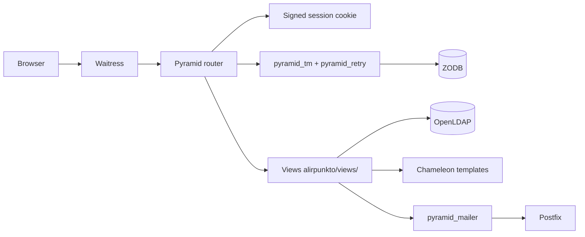

# Runtime architecture

> Status: current documentation.

## Request-processing chain

Configuration is centralised in `alirpunkto/__init__.py`:

- `pyramid_chameleon` for TAL/METAL rendering;
- `pyramid_tm` and `pyramid_retry` (3 attempts, `development.ini`): each
  request is one transaction; e-mails handed to `pyramid_mailer` only leave
  at *commit* time;
- `pyramid_zodbconn` provides the request's ZODB connection;
- the session factory is `SignedCookieSessionFactory` (signed cookie,
  `httponly`, `secure`, `SameSite=Lax`);
- `config.set_default_csrf_options(require_csrf=True)` enforces CSRF
  protection on every view;
- a `BeforeRender` subscriber (`add_renderer_globals`) injects the template
  globals;
- `alirpunkto.request_log` installs the outermost tween of the chain
  (under `INGRESS`, above `pyramid_tm` and the exception views): a trace
  of every request and response, and a log entry, with traceback, for
  every exception escaping the stack (see below).

## Logging

The `.ini` files split two streams:

- the `alirpunkto` logger (`propagate = 0`) writes to
  `var/log/alirpunkto.log`; it only sees what the application emits;
- the root logger writes to `stderr`, that is the `systemd` journal
  (`journalctl -u alirpunkto`) on a bare server, or `docker logs` in the
  Docker stack. This is where Waitress reports, on its own logger, an
  exception escaping the stack ("Exception while serving …").

Production diagnosis of 30 October 2026: a click on "Login" answered
*Internal Server Error* and the application file stayed empty despite the
`DEBUG` level — the traceback only lived in the journal, and no view
logged the request. The `alirpunkto.request_log` tween now gives the
application file the whole story of a navigation:

| Event | Level | Line |
|---|---|---|
| Request entering | DEBUG | `request GET /sso_login?code,state from 203.0.113.5` |
| Response rendered | DEBUG (WARNING for a 5xx built by the stack) | `response … -> 302 Found route=sso_login user=alice in 12 ms` |
| Escaping exception | ERROR, with the traceback | `unhandled TypeError on GET /sso_login from … after 3 ms: …` |

The query string is logged through its parameter **names** only (an SSO
`code`, an encrypted `oid` link, a `state` are never copied — transversal
audit of 24 October 2026, A12). The pseudonym is read only when the view
itself opened the session: the tween never opens one (a signed-cookie
session is re-issued on every access). The exception is re-raised
unchanged after logging: Waitress still sees it.

## Routes

Routes are declared in `alirpunkto/__init__.py`; `alirpunkto/routes.py`
only serves the static view (`/static`).

| Route | Path | View |
|---|---|---|
| `home` | `/` | `views/home.py` |
| `login` / `logout` | `/login`, `/logout` | `views/login.py`, `views/logout.py` |
| `register` | `/register` | `views/register.py` (candidature) |
| `forgot_password` | `/forgot_password` | `views/forgot_password.py` |
| `modify_member` | `/modify_member` | `views/modify_member.py` |
| `get_email` / `check_new_email` | `/get_email`, `/check_new_email` | e-mail address change |
| `elections` / `vote` | `/elections`, `/vote` | verifiers' vote |
| `manage_provider` | `/manage_provider` | provider management |
| `sso_login` + Keycloak redirect | `/sso_login`, `/<KEYCLOAK_REDIRECT_PATH>` | `views/sso_login.py` |

## Templates

Pages inherit from `templates/layout.pt` (shared METAL structure); each view
has its template (`login.pt`, `register.pt`, `home.pt`, …). Rich forms use
Deform (`templates/deform/`).

## Known limits

- Routes are declared inline in `__init__.py`; `routes.py` is nearly empty,
  so the announced separation never materialised.
