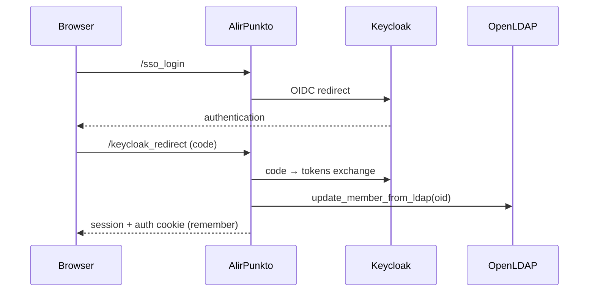

# Authentication

> Status: current documentation.
> Modules: `alirpunkto/views/login.py`, `alirpunkto/views/sso_login.py`,
> `alirpunkto/views/home.py`, `alirpunkto/utils.py` (`store_sso_tokens`,
> `logout`), `alirpunkto/views/logout.py`.

## Two entry paths

1. **Local form** (`/login`): the pseudonym is resolved to an `oid`
   (`get_oid_from_pseudonym`), then `check_password` attempts an LDAP
   *bind* — slapd verifies `{SSHA}` passwords natively. On success the view
   synchronises the member (`update_member_from_ldap`) and also requests a
   Keycloak token (`get_keycloak_token`) to align the SSO session.
2. **Keycloak SSO** (`/sso_login` plus the `/keycloak_redirect` route):
   OIDC flow; the token is verified (signature, audience, expiry through
   `jwt`), the `oid` extracted from it, the member synchronised from LDAP,
   then the session is opened.

## Session content

The session is a **signed cookie** (`SignedCookieSessionFactory`,
`httponly`, `secure`, `SameSite=Lax`) limited to 4093 bytes. It only holds
the strict minimum: `logged_in`, `user` (a lightweight `User` object as
JSON), `created_at`, and — through `utils.store_sso_tokens` — the Keycloak
**refresh token** and its expiry. The *access token* is deliberately
**not** stored: nothing ever reads it back and its group claims overflowed
the cookie (incident of 2026-07-08, locked by
`tests/test_session_cookie_budget.py`). Pyramid identification uses
`remember(request, pseudonym)` (a separate *auth tkt* cookie).

## Refresh and logout

`home_view` keeps the SSO session alive while the refresh token's expiry
has not passed (`refresh_keycloak_token`, then `store_sso_tokens`) and logs
out cleanly otherwise. `utils.logout` purges the session (user, tokens);
`/logout` closes it on the interface side.

## Known limits

- The refresh token lives in the session cookie, now **sealed**
  (compressed then encrypted — see the hardening section): the cookie
  bearer can no longer read it. The long-term target remains a
  server-side session (see
  [architecture_decisions](architecture_decisions.md)).

## Deactivated accounts (2026-07-30)

`sso_login` refuses a member whose `data.is_active` is false (a resigned
or deactivated account): the guard sits after the resynchronisation from
LDAP and before the session `User` is built. The LDAP entry, kept through
the Quarantine, therefore reopens no access.

## External-audit hardenings (2026-08-01)

**The post-login redirect is bound to the site.** The login view
honoured `session['redirect_url']` blindly; `safe_local_redirect` now
only accepts a same-site target — an absolute URL whose authority is
exactly the request's host (the legitimate case of views storing
`current_route_url()`), or a local `/…` path (never `//…`); exotic
schemes, backslashes and `user@host` tricks fall back to home, and the
session key is purged either way.

**Login attempts are limited before any LDAP work**: two sliding
windows (10 per address over 5 minutes; 5 per username over 15 minutes
across addresses), cleared on success, a uniform translated answer, and
a password-free log line. The state lives in process memory — the
choice is documented in `login_throttle.py` and matches the deployment
(a single Waitress process); for the address window to see real client
IPs behind Apache, Waitress now trusts the proxy (`trusted_proxy` in
`production.ini`).

**Login reads POST only.** The form is processed only when the method
is `POST`, and the credentials are read from `request.POST` alone: a
crafted `/login?form.submitted=1&username=…` URL no longer triggers
anything — a test checks that neither the pseudonym lookup nor
`is_admin` is called on a GET (credentials thereby leave the access
logs and the browser history). The Keycloak calls furthermore carry
timeouts (3 s connect, 10 s read), fail cleanly to `None`, and never
log a raw response body.

**The refresh token is sealed and the Keycloak responses validated**
(sixth pass, 2026-08-01). The session cookie is signed, not encrypted:
the token now travels **compressed then encrypted**
(`seal_sso_refresh_token` — zlib level 9 then Fernet on `SECRET_KEY`;
compression first, because ciphertext is incompressible and the worst
case would have crossed the 4093-byte cookie limit of the 2026-07-08
incident again; the token being alone in the compressed stream, no
compression oracle opens). Anything that does not decrypt — a tampered
value, a pre-change clear-text session — reads as an expired SSO
session: clean logout, fresh login, seamless migration. And every 200
response of the token endpoint goes through
`_validated_token_payload`: JSON parsed under guard, `access_token`
and `refresh_token` required non-empty, strict integer lifetimes
bounded to 90 days, failures logged without the body.

**Architecture decision**: Keycloak will not become the single
authentication entry point. The test server is not connected to
Keycloak and hosts only AlirPunkto; direct LDAP authentication is an
assumed path, the Keycloak integration remaining the acquisition of an
SSO token after the local authentication.

### Propagation of directory changes to Keycloak (issues #266, #269)

Keycloak mirrors the directory through its *user federation*, but
lazily: a new entry is imported the first time Keycloak looks it up, an
existing one is refreshed only when the member authenticates through
Keycloak again. Until then the mailing lists and the workspace, which
read their users and groups from Keycloak, know nothing of the fresh
registration (#266) nor of the member whose Dynamic Group just changed
(#269). The module `alirpunkto/keycloak_sync.py` closes that gap with
two mechanisms, both **best effort** — a Keycloak outage never breaks
the operation that triggered them, exactly like the group synchroniser:

- `propagate_ldap_changes_to_keycloak` asks Keycloak, through its admin
  API, for a *changed users* synchronisation of every LDAP user-storage
  provider of the realm: Keycloak re-imports the entries whose
  `modifyTimestamp` moved since its last pass, and its group mappers
  follow. The call is made by `utils.notify_keycloak_of_directory_change`
  at the end of **every write that changes what the SSO side mirrors**:
  entry creation (`register_user_to_ldap`), upgrade to Cooperator
  (`upgrade_member_in_ldap`), profile or financial update
  (`update_ldap_member`), deactivation (`deactivate_member_in_ldap`), and
  by the daily scan when at least one member changed group
  ([09_periodic_tasks](09_periodic_tasks.md)).
  **Required Keycloak configuration**: the `KEYCLOAK_CLIENT_ID` client
  must have *service accounts* enabled and carry the `view-realm` (list
  the components) and `manage-users` (trigger the synchronisation) roles
  of the `realm-management` client. Without them the call is refused and
  logged as a warning; the rest of the application is unaffected;
- `import_member_into_keycloak` performs, right after a successful
  ordinary-member registration, the password grant the login view
  already uses: Keycloak looks the new member up in the directory and
  imports the entry. No extra privilege, only the password the member
  just chose — hence its reservation to the registration path (the
  Cooperators approved by vote, whose password is no longer in clear,
  are covered by the propagation).

Both honour the `PYTEST_CURRENT_TEST` guard of `get_keycloak_token`;
`tests/test_keycloak_sync.py` locks the calls and the event sources.

### Departure-state guard (issue #265)

Since train 0109 the login view consults `member_state` right after the LDAP authentication: an account in `UNSUBSCRIBED`, `EXCLUDED` or `DELETED` state is refused with the translated `login_account_disabled` message, even while the directory still authenticates its credentials. Living states pass unchanged; both directions are locked by `tests/test_departure_tickets.py`.
