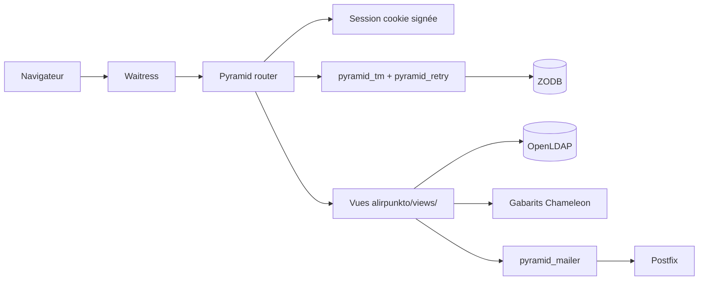

# Architecture d'exécution

> Statut : documentation courante.

## Chaîne de traitement d'une requête

La configuration est centralisée dans `alirpunkto/__init__.py` :

- `pyramid_chameleon` pour le rendu TAL/METAL ;
- `pyramid_tm` et `pyramid_retry` (3 tentatives, `development.ini`) : chaque
  requête est une transaction ; les courriels remis à `pyramid_mailer` ne
  partent qu'au *commit* ;
- `pyramid_zodbconn` fournit la connexion ZODB de la requête ;
- la fabrique de session est `SignedCookieSessionFactory` (cookie signé,
  `httponly`, `secure`, `SameSite=Lax`) ;
- `config.set_default_csrf_options(require_csrf=True)` impose la protection
  CSRF à toutes les vues ;
- un abonné `BeforeRender` (`add_renderer_globals`) injecte les globales de
  gabarit ;
- `alirpunkto.request_log` installe le tween le plus externe de la chaîne
  (sous `INGRESS`, au-dessus de `pyramid_tm` et des vues d'exception) :
  trace de chaque requête et de chaque réponse, et journalisation, avec
  trace d'appel, de toute exception qui s'échappe de la pile (voir
  ci-dessous).

## Journalisation

Les fichiers `.ini` séparent deux flux :

- le logger `alirpunkto` (`propagate = 0`) écrit dans
  `var/log/alirpunkto.log` ; il ne voit que ce que l'application émet ;
- le logger racine écrit sur `stderr`, c'est-à-dire dans le journal de
  `systemd` (`journalctl -u alirpunkto`) sur un serveur nu, ou dans
  `docker logs` dans la pile Docker. C'est là que Waitress signale, sur son
  propre logger, une exception qui s'échappe de la pile (« Exception while
  serving … »).

Diagnostic de production du 30 octobre 2026 : un clic sur « Se connecter »
répondait *Internal Server Error* et le fichier de l'application restait
vide malgré le niveau `DEBUG` — la trace d'appel n'était que dans le
journal, et aucune vue ne journalisait la requête. Le tween
`alirpunkto.request_log` donne désormais au fichier de l'application
l'histoire complète d'une navigation :

| Événement | Niveau | Ligne |
|---|---|---|
| Entrée d'une requête | DEBUG | `request GET /sso_login?code,state from 203.0.113.5` |
| Réponse rendue | DEBUG (WARNING pour un 5xx construit par la pile) | `response … -> 302 Found route=sso_login user=alice in 12 ms` |
| Exception qui s'échappe | ERROR, avec la trace d'appel | `unhandled TypeError on GET /sso_login from … after 3 ms: …` |

La chaîne de requête n'est journalisée que par les **noms** de ses
paramètres (un `code` SSO, un lien `oid` chiffré, un `state` ne sont jamais
copiés — audit transversal du 24 octobre 2026, A12). Le pseudonyme n'est lu
que si la vue a elle-même ouvert la session : le tween n'en ouvre jamais
une (une session à cookie signé est réémise à chaque accès). L'exception est
relancée telle quelle après journalisation : Waitress la voit toujours.

## Routes

Les routes sont déclarées dans `alirpunkto/__init__.py` ; `alirpunkto/routes.py`
ne sert que la vue statique (`/static`).

| Route | Chemin | Vue |
|---|---|---|
| `home` | `/` | `views/home.py` |
| `login` / `logout` | `/login`, `/logout` | `views/login.py`, `views/logout.py` |
| `register` | `/register` | `views/register.py` (candidature) |
| `forgot_password` | `/forgot_password` | `views/forgot_password.py` |
| `modify_member` | `/modify_member` | `views/modify_member.py` |
| `get_email` / `check_new_email` | `/get_email`, `/check_new_email` | changement d'adresse |
| `elections` / `vote` | `/elections`, `/vote` | vote des vérificateurs |
| `manage_provider` | `/manage_provider` | gestion des prestataires |
| `sso_login` + redirection Keycloak | `/sso_login`, `/<KEYCLOAK_REDIRECT_PATH>` | `views/sso_login.py` |

## Gabarits

Les pages héritent de `templates/layout.pt` (structure METAL commune) ; chaque
vue a son gabarit (`login.pt`, `register.pt`, `home.pt`, etc.). Les formulaires
riches utilisent Deform (`templates/deform/`).

## Limites connues

- Les routes sont déclarées en dur dans `__init__.py` ; `routes.py` est
  quasi vide, la séparation annoncée n'est pas aboutie.
